<picture>
  <source media="(prefers-color-scheme: dark)" srcset="banner-dark.svg">
  
</picture>

## À propos

Développeur fullstack **Next.js · TypeScript · Node.js**, titulaire du titre **CDA spécialité IA** (Concepteur Développeur d'Applications, bac+3) obtenu à La Fabrique Numérique Paloise.

Avant le développement, j'ai passé 12 ans en grande distribution et, en parallèle, 10 ans dans la gestion administrative de l'entreprise familiale, où j'ai automatisé la facturation sous Excel. Je sais ce qu'un logiciel change au quotidien pour ceux qui l'utilisent.

Je conçois, développe et exploite mes applications seul, du recueil du besoin à la mise en production.

## Projets

### SmartPlanning

<a href="https://smartplanning.fr">
  <picture>
    <source media="(prefers-color-scheme: dark)" srcset="smartplanning-dark.svg">
    
  </picture>
</a>

[smartplanning.fr](https://smartplanning.fr) · [Code source](https://github.com/krismos64/SmartplanningAI-V2)

SaaS multi-entreprise de gestion des plannings et des congés d'équipe, en production.

- **Stack** : Next.js · React · TypeScript · PostgreSQL · Prisma · Redis · Stripe
- **Fonctionnel** : rôles direction, manager et employé, planning en glisser-déposer, workflow de congés, messagerie et notifications temps réel (SSE), abonnement Stripe par employé
- **Sécurité** : contrôle d'accès par rôle, isolation stricte entre entreprises, validation Zod, limitation de débit sur Redis
- **Production** : CI/CD GitHub Actions vers Docker sur VPS OVH, retour arrière automatique si le contrôle de santé échoue, sauvegardes chiffrées copiées hors site

### Lune-soleil

<a href="https://lune-soleil.fr">
  <picture>
    <source media="(prefers-color-scheme: dark)" srcset="lune-soleil-dark.svg">
    
  </picture>
</a>

[lune-soleil.fr](https://lune-soleil.fr) · [Code source](https://github.com/krismos64/lune-soleil)

Boutique e-commerce sur mesure pour une créatrice de bijoux artisanaux du Béarn : catalogue, paiement, stock partagé entre le site et les marchés, facturation, expédition.

- **Stack** : Next.js · TypeScript strict · PostgreSQL · Prisma · Better Auth (passkeys) · Stripe
- **Paiement fiable** : réservation atomique des pièces uniques, webhooks signés et idempotents, montants en centimes, factures immuables
- **Usage réel** : back-office conçu pour le smartphone, utilisable sur les marchés
- **Conformité** : droit de rétractation, médiation de la consommation, RGPD

## Ma façon de travailler

- **Tests bloquants en CI** (Vitest, Playwright, axe-core) et mutation testing pour vérifier que les tests détectent vraiment les défauts
- **Décisions d'architecture documentées** (ADR) et journal de développement
- **Déploiement continu** avec retour arrière, sauvegardes dont la restauration est testée
- **Incidents analysés** jusqu'à leur cause, corrigés et documentés
- **Agile / Scrum** avec Jira et Confluence
- **Développement assisté par IA encadré** : règles de projet, hooks de vérification, revue systématique

## Stack

## Parcours

- **CDA spécialité IA** (Concepteur Développeur d'Applications, bac+3) · La Fabrique Numérique Paloise · 2024 – 2026
- **DWWM** (Développeur Web et Web Mobile, bac+2) · Studi · 2022 – 2023
- **Avant le développement** : 12 ans en grande distribution et, en parallèle, 10 ans de gestion administrative dans l'entreprise familiale

